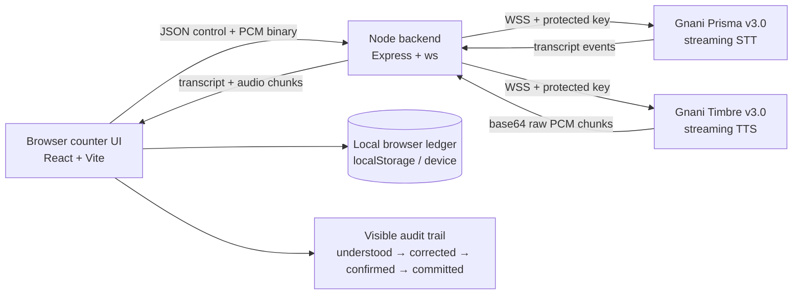

# HISAAB PAKKA

**Correction-safe voice khata for kirana counters.**

HISAAB PAKKA lets a shopkeeper record credit and repayments in natural Hindi–English code-mix, resolve same-name customers, correct an amount before saving, and ask for exact balances. The ledger changes only after an explicit confirmation.

> “The ledger does not change just because an AI guessed. It changes after the shopkeeper has corrected and confirmed it.”

## What is implemented

The prototype is a single counter screen with a push-to-talk microphone, a backend-protected Gnani WebSocket bridge, deterministic local ledger storage, same-name customer clarification, spoken correction, relative dates (`aaj`, `kal`, `parso`), compound credit/payment drafts, daily-credit queries, customer-balance queries, duplicate-safe commits, and a visible `understood → corrected → confirmed → committed` audit trail. It also includes functional `/privacy` and `/terms` routes that explain the synthetic-data and prototype boundaries.

The demo data is synthetic: Ramesh–doodhwala, Ramesh–electrician, and Suresh. No real customer data or call recordings are used. The browser ledger is stored locally and raw transcripts are not persisted by the application.

## Run it

```bash
npm install
npm run dev
```

Open the managed Preview or `http://localhost:3000`. Use the large push-to-talk control for the actual voice path. The small text field is a development test lane; it is intentionally labelled and is not a substitute for the Gnani voice demo.

For local development outside the managed project environment, copy `.env.example` to `.env` and set `GNANI_API_KEY_ID`. Keep the value server-side. Never place it in `src/`, commit it, or paste it into public documentation. In the managed project, the key is stored through protected project configuration.

Useful checks:

```bash
npm run typecheck
npm test
npm run build
```

## Gnani integration

The backend pins the required hackathon models rather than relying on provider defaults.

- Prisma v3.0 STT: `wss://api.vachana.ai/stt/v3/stream`
- Required STT headers: `x-api-key-id`, `model=prisma-v3.0`, `language_code=indic-auto`, and `x-sample-rate=16000`
- STT audio: 16-bit mono PCM frames from the browser; a JSON `{ "type": "commit" }` control frame is sent on push-to-talk release.
- Timbre v3.0 TTS: `wss://api.vachana.ai/api/v1/tts`
- Required TTS header: `X-API-Key-ID`
- TTS request: `model=timbre-v3.0`, `voice=Shivani`, `language=hi-en`, raw linear PCM at 48 kHz.

The official documentation used for the implementation is [Gnani realtime STT](https://docs.gnani.ai/api/STT/stt-websocket), [Gnani realtime TTS](https://docs.gnani.ai/api/TTS/tts-websocket), and [Gnani quick start](https://docs.gnani.ai/api/introduction/quick-start).

A live non-secret smoke test was run against both WebSockets with the configured key: Prisma returned a `connected` event; Timbre returned `complete` with 31 audio chunks and 92,160 audio bytes for a short “Namaste” synthesis request. The browser microphone round trip still needs to be rehearsed on the actual judge device and network because microphone permission, device sample-rate behavior, and counter noise are environment-dependent.

## Architecture



The browser owns the demo ledger because PS2 permits local-device storage. The Node process owns the Gnani credential and all speech-provider connections. The interpreter can create drafts and queries, but only `commitTransactions` can mutate the ledger, and it uses a commit ID to prevent duplicate writes.

## Safety and correctness boundaries

The app does not silently save uncertain amounts, customers, or direction. Same-name customers trigger a clarification. “Suresh ko do sau diye” triggers a direction question rather than guessing whether money went to or came from Suresh. A correction updates the draft and leaves the ledger untouched until confirmation. Financial arithmetic is deterministic integer rupee arithmetic; no LLM performs money calculations.

The first assistant message discloses that it is an AI. The demo uses synthetic data, does not implement pressure-based reminders, does not clone a voice, and keeps the API key out of the frontend.

## Two-to-three-minute judge demo

**0:00–0:15 — disclosure.** Say: “This is Hisaab Pakka. The ledger does not change just because an AI guessed. It changes after the shopkeeper has corrected and confirmed it.” Let the assistant say: “Namaste, main Hisaab Pakka ka AI sahayak hoon. Aap udhaar aur jama bol sakte hain.”

**0:15–0:50 — compound entry and identity.** Say: “Ramesh ka aaj teen sau chaalis udhaar, aur kal do sau jama kiye the.” The assistant should ask: “Doodhwale Ramesh, ya electrician Ramesh?” Say “Doodhwale.” The draft should show two dated entries.

**0:50–1:20 — correction.** While the read-back is active, press the button again and say: “Nahi, udhaar chaar sau tees.” The draft should change only the credit amount to ₹430. Say “Haan, save.” Only after commit should the balance and history update.

**1:20–1:45 — required queries.** Ask: “Aaj kitna udhaar gaya?” Then ask: “Doodhwale Ramesh ka total?” The answers must come from the local ledger and show the measured response timing when available.

**1:45–2:10 — controlled ambiguity.** Say: “Suresh ko do sau diye.” The assistant must ask: “Udhaar gaya ya jama mila?” Cancel the draft by voice. Explain that the system asks because direction changes the ledger.

**2:10–2:40 — judge handoff.** Ask the judge to try another amount, a correction, or either Ramesh. Do not claim broader language coverage until it has been tested.

## Six-slide pitch outline

1. **The counter problem:** speech is fast, but one wrong amount or direction damages trust.
2. **The market reality:** digital khata and voice entry already exist; voice alone is not the novelty claim.
3. **Our narrow contribution:** clarify, repair, confirm, and show the reason for every commit.
4. **The architecture:** browser push-to-talk, Node bridge, Prisma v3.0 STT, Timbre v3.0 TTS, local deterministic ledger.
5. **Evidence:** six passing deterministic tests; live Gnani WebSocket smoke test; measured browser/device latency to be recorded during rehearsal; known environmental limitations stated honestly.
6. **Next validation:** judge-device noise tests, real shopkeeper usability research with consent, broader code-mix coverage, and competitor comparison.

## Judging checklist

- **Live judge test:** the complete flow is visible on one responsive counter screen; the text lane is only for development diagnostics.
- **Speech layer:** actual Prisma v3.0 streaming STT and Timbre v3.0 streaming TTS are wired through WebSockets; VAD is tuned for short commands and noisy laptop microphones.
- **Target-user fit:** push-to-talk, large touch target, short bilingual prompts, and no typing requirement in the target flow.
- **Innovation:** correction-safe, auditable commits and clarification instead of silent guesses.
- **Responsible AI:** AI disclosure, synthetic data, server-only key, no voice cloning, no coercive reminders, and no LLM arithmetic.
- **Demo and docs:** this README, architecture diagram, setup commands, demo script, pitch outline, tests, and known limitations are included.

## Project structure

```text
src/App.tsx                 Counter interface and live session state
src/lib/ledger.ts           Local storage, balances, integer arithmetic, idempotent commits
src/lib/conversation.ts     Constrained amount/date/direction parser and state machine
server/index.ts             Express/Vite server and browser WebSocket bridge
server/gnani.ts             Prisma v3.0 and Timbre v3.0 WebSocket adapters
plan.md                     Implementation and design decisions
TODO.md                     Acceptance criteria and delivery state
```
